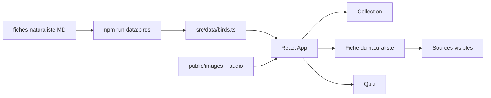

# Architecture

Voir aussi le [plan](plan.md).

## Principes

- Application **100 % statique** (pas de backend ni base serveur)
- Source de vérité métier : Markdown des **fiches du naturaliste**
- Données runtime : TypeScript / JSON dérivés des fiches
- Déploiement : Vercel (projet **OrnithoDex**) ; code : GitHub (repo **OrnithoDex**)

## Flux



Générateur : [`scripts/build-birds.mjs`](../../scripts/build-birds.mjs) — identité, points de cours, médias, `wildRange`, sources, sections biologie sourcées.

Médias locaux : `npm run media:fetch` (Commons → WebP, Xeno-canto → MP3) puis `npm run data:birds`. Manifest : [`public/media-manifest.json`](../../public/media-manifest.json).

Prompts visuels : [`scripts/build-visual-prompts.mjs`](../../scripts/build-visual-prompts.mjs) → [`documentation/ornithologie/prompts-visuels/`](../../ornithologie/prompts-visuels/) (`npm run data:prompts`).

Cartes pédagogiques : [`public/maps/hemisphere-*.svg`](../../public/maps/) + composant `WildRangeMap` (régions uniquement si documentées).

## Stack

- Vite
- React
- TypeScript
- Tailwind CSS

## Structure cible

```
ornithologie/
  documentation/
  public/
    images/birds/{slug}.webp
    audio/birds/{slug}.mp3
  src/
    data/birds.ts
    types/bird.ts
    components/
    pages/
    lib/quiz.ts
  README.md
  index.html
```

## Modèle de données

Types principaux : `SourceRef`, `SourcedText`, espèce avec `sheet.status` (`liste_seule` | `partielle` | `complete`).

Règle : `sourceIds` obligatoire dès qu’un texte de section est non vide. Identité programme toujours liée à `programSourceId` (liste BAC PRO TCVA).

## Hébergement et CI/CD

| Environnement | Déclencheur |
|---------------|-------------|
| Preview Vercel | Push / PR vers `develop` |
| Production Vercel | GitHub Release (`release: published`) via Actions |

Secrets attendus : `VERCEL_TOKEN`, `VERCEL_ORG_ID`, `VERCEL_PROJECT_ID`.

Détail Gitflow : [conventions.md](conventions.md).
