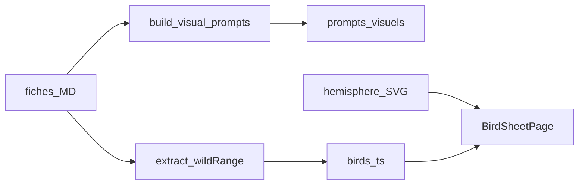

# Plan — Prompts visuels + carte hémisphère

Document de référence consigné le **2026-10-10**. Complète le [plan projet](plan.md). Toute évolution majeure → ce fichier + [journal](../journal/).

Sprint d’exécution : [sprint-prompts-visuels.md](sprint-prompts-visuels.md).

## Vue d’ensemble

Pour chaque espèce du programme (85) :

1. Un **prompt d’illustration naturaliste** (planche type field-guide)
2. Un **prompt de modèle 3D réaliste** (prêt Meshy / générateur image→3D)
3. Un **fond d’hémisphère** sur la fiche pour situer la **répartition sauvage** — uniquement si documentée et sourcée

## Contexte

| Élément | État |
|---------|------|
| Dataset `birds.ts` | Identité, points de cours, médias, sections biologie — **pas de géo structurée** |
| Habitat dans les fiches | **85/85** |
| Régions / pays | Souvent dans Description (EOO, endemicité) ; **pas** de lat/long ni GeoJSON |
| Médias locaux | Images / sons sous `public/` (voir médias) ; prompts ≠ assets générés |

## Décisions

| Sujet | Choix |
|-------|--------|
| Langue des prompts | **Anglais** (génération Meshy / image) ; en-tête **FR** (nom commun, slug) |
| Stockage | **Un Markdown par espèce** : `documentation/ornithologie/prompts-visuels/{slug}.md` + `_index.md` |
| Carte | SVG hémisphère + highlights **seulement** si régions/pays déjà écrits dans la fiche |
| Invention | **Interdite** — champ vide → « Non documenté » |

## Règle d’intégrité

- Morphologie / habitat / répartition dans les prompts = **reformulation** de faits déjà présents et sourcés dans la fiche
- Ne pas ajouter de couleurs, dimorphisme, pays ou biome absents de la fiche
- Formes domestiques : ne pas inventer une aire « sauvage » si la fiche ne la documente pas
- EOO (km²) ≠ empreinte géographique — ne pas en déduire des coordonnées

## Livrable A — Catalogue de prompts

Script `scripts/build-visual-prompts.mjs` + `npm run data:prompts`.

Chaque `{slug}.md` contient :

1. Identité (commun, latin, ordre, famille)
2. Prompt **illustration naturaliste** (EN) — planche claire, fond crème, style plat aligné DA OrnithoDex
3. Prompt **3D réaliste** (EN) — sujet unique, pose claire, studio neutre
4. Garde-fous négatifs (no text, no watermark, no traits inventés)
5. `sourceIds` des sections utilisées

Si Description / Dimorphisme vides ou `na` : prompts limités à identité + habitat, marqués « faits limités — ne pas enrichir ».

## Livrable B — Répartition sauvage (`wildRange`)

Étendre [modele-fiche-naturaliste.md](../ornithologie/modele-fiche-naturaliste.md) :

```markdown
## Répartition sauvage

| Champ | Valeur | Source |
|-------|--------|--------|
| Régions / pays | … | birdlife-… |
| Hémisphère / realm | AF \| AU \| AS \| AM \| EU \| multi \| na | … |
| Note | … | … |
```

Runtime (`src/types/bird.ts`) :

```ts
wildRange?: {
  regions: string[]
  hemisphere?: 'AF' | 'AU' | 'AS' | 'AM' | 'EU' | 'multi'
  summary?: string
  sourceIds: string[]
}
```

Extraction automatique dans `scripts/build-birds.mjs` : toponymes **déjà présents** dans Description / Habitat (liste contrôlée). Aucun toponyme → pas de highlight.

Complétion manuelle BirdLife des fiches = passe ultérieure.

## Livrable C — Fond hémisphère + UI fiche

Assets SVG sous `public/maps/` :

- `hemisphere-east.svg` — Afrique / Europe / Asie / Océanie
- `hemisphere-west.svg` — Amériques
- `hemisphere-world.svg` — multi / fallback

Composant `src/components/WildRangeMap.tsx` sur `BirdSheetPage` :

- Fond selon `hemisphere`
- Pastilles / realms documentés (pas de lat/long inventées)
- Liste textuelle des régions
- Sans `wildRange` : fond discret + « Non documenté »

## Flux



## Hors périmètre

- Génération effective Meshy / Inkscape des 85 × 2 assets (PNG / GLB)
- Shapefiles / polygones BirdLife
- Refonte maquette globale (maquettes non validées séparément)

## Critères de done

- [x] 85 fichiers prompts + `_index.md`
- [x] Type + dataset `wildRange` (vide autorisé)
- [x] 3 SVG hémisphère + composant fiche
- [x] Gabarit fiche mis à jour
- [x] `npm run build` OK
- [x] Journal + PR → `develop`
- [x] Aucune géographie inventée affichée comme fait

## Documents liés

- [Sprint](sprint-prompts-visuels.md)
- [Plan projet](plan.md)
- [Architecture](architecture.md)
- [Charte design](design.md)
- [Pédagogie](pedagogie.md)
- [Modèle fiche](../ornithologie/modele-fiche-naturaliste.md)
