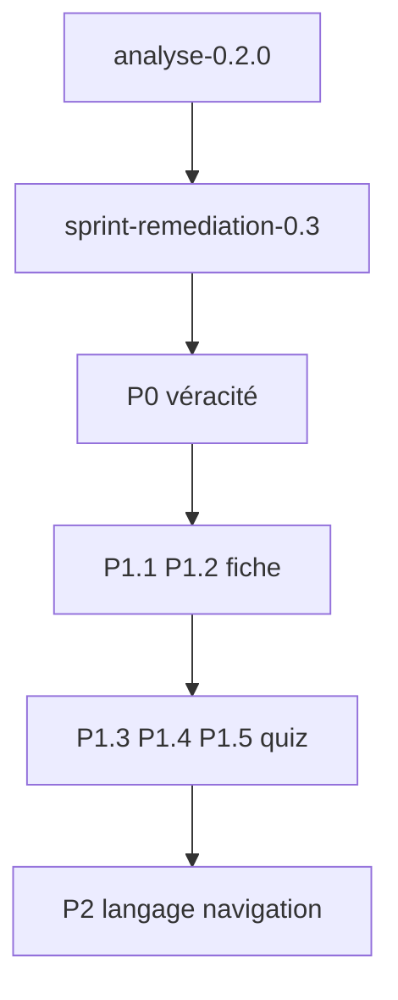

# Plan — Remédiation pédagogique (cible 0.3.x)

Document de référence consigné le **2026-10-11**. Issu de [analyse-pedagogique-0.2.0.md](analyse-pedagogique-0.2.0.md). Exécution découpée en sprints ; premier : [sprint-remediation-pedagogie-0.3.md](sprint-remediation-pedagogie-0.3.md).

## Objectif

Rendre la v0.3 alignée sur [pedagogie.md](pedagogie.md) pour la **seconde pro TCVA** : véracité visible, points de cours correctement étiquetés, fiche exploitable, quiz qui consolide (pas seulement le nom commun).

## P0 — Véracité (bloquant)

| Id | Action | Critère de done |
|----|--------|-----------------|
| P0.1 | Bloc **Sources** en bas de fiche + `sourceIds` lisibles par point de cours | Chaque point `sourcé` affiche au moins un id / titre ; liste des `bird.sources` visible |
| P0.2 | Re-étiqueter / scinder les **61** points `[programme]` listés en annexe de l’analyse | 0 point `programme` avec plumage / UICN / habitat / synonyme BirdLife ; regen `npm run data:birds` |
| P0.3 | Contrôle illustrations vs photo (échantillon puis plan 85) | Tableau statut `ok` / `à reprendre` / `accepté avec réserve` dans suivi illustrations ; les `à reprendre` hors Collection ou remplacées |
| P0.4 | Vérifier embeds XC (4 espèces) | Si le nom apparaît dans l’iframe → quiz chant n’utilise que audio local, ou masque l’embed |

## P1 — Rétention

| Id | Action | Critère de done |
|----|--------|-----------------|
| P1.1 | Afficher **audio** sur la fiche (si média présent) | Bouton / lecteur ; pas de champ vide affiché comme fait |
| P1.2 | Afficher sections naturalistes utiles (ou extrait) | Au moins habitat / description si texte non vide ; jamais inventer |
| P1.3 | Feedback quiz : lien **Revoir la fiche** + rappel contraste si dispo | Après erreur : CTA vers `/espece/{id}` ; 1 phrase contrastante si point adapté |
| P1.4 | Séries de **10** questions + reprise des erreurs | Fin de série ; score de série ; option « rejouer les ratés » ; reset score série (pas seulement cumul vie) |
| P1.5 | Mode quiz **nom → ordre** (ou famille) | 4 choix ; pool ≥ 4 ; faits programme uniquement |

## P2 — Langage & navigation

| Id | Action | Critère de done |
|----|--------|-----------------|
| P2.1 | Statuts UICN en français dans les points | `Préoccupation mineure`, `Quasi menacé`, etc. — pas d’anglais nu |
| P2.2 | Synonymes BirdLife hors points de cours (fiche / sources seulement) | Points de cours = latin **programme** |
| P2.3 | Supprimer / réécrire points méta | Plus de « premier du lot », « audio de référence », « Paradise-whydah » |
| P2.4 | Filtre **Famille** en Collection | Select famille (dépendante de l’ordre ou globale) |
| P2.5 | Arbitrage photo / illustration fiche | Docs alignés : illustration haut (collection) + photo sourcée visible sans scroll excessif ; `pedagogie.md` mis à jour |

## Ordre d’exécution recommandé

1. Sprint 0.3 = **P0 + P1.1 + P1.2 + P1.3** (voir sprint dédié).
2. Sprint suivant = P1.4 + P1.5.
3. Sprint langage = P2.

## Hors périmètre

- SRS / flashcards
- Compte utilisateur
- Enrichissement naturaliste nouveau (reste sprints sources)
- Génération massive de nouvelles illustrations (seulement reprise des `à reprendre`)

## Documents liés

| Document | Rôle |
|----------|------|
| [analyse-pedagogique-0.2.0.md](analyse-pedagogique-0.2.0.md) | Diagnostic |
| [sprint-remediation-pedagogie-0.3.md](sprint-remediation-pedagogie-0.3.md) | Premier sprint |
| [pedagogie.md](pedagogie.md) | Charte |
| [design.md](design.md) | Specs UI |
