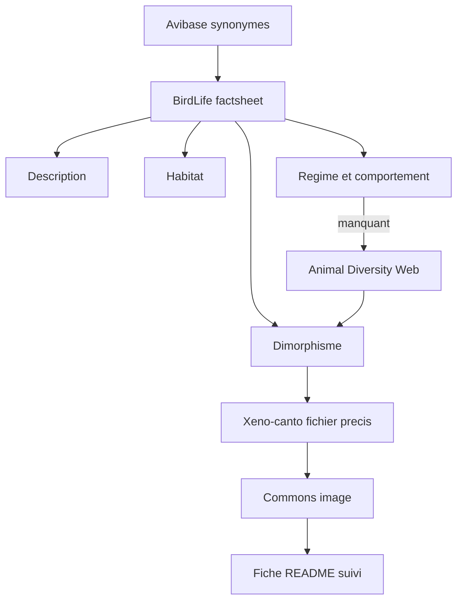

# Plan — Recherche de sources fiables par espèce (OrnithoDex)

Document de référence consolidé le **2026-10-10** (révision : fiches naturalistes **complètes**).  
Complète le [plan projet V1](plan.md). Toute évolution de méthode doit mettre à jour ce fichier et le [journal](../journal/).

## Vue d’ensemble

Enrichissement systématique des **85 fiches du naturaliste** vers le statut `complete` (7 sections biologie/médias), avec registre dans le [README racine](../../README.md).

**Points de cours** : traités dans le [plan pédagogie](plan-pedagogie.md) (pas de polycopié enseignant ; aides à la rétention dérivées de la liste programme + faits sourcés). Ils ne bloquent pas le statut `complete` naturaliste.

## Périmètre retenu

Pour chaque espèce du référentiel ([especes.md](../ornithologie/especes.md)) :

| Inclus (viser `complete`) | Exclu / différé |
|---------------------------|-----------------|
| Description | Points de cours → [plan-pedagogie.md](plan-pedagogie.md) |
| Dimorphisme sexuel | Scaffold applicatif Vite/React |
| Habitat d’origine | Copie locale massive dans `public/` avant validation licence |
| Régime alimentaire | |
| Comportement | |
| Chant et vocalisations (fichier XC précis) | |
| Médias (1 image Commons + 1 audio XC) | |

Règle inchangée : pas de source = section vide ou `na` motivé ; rien n’est inventé ; toute source ajoutée au README racine. Voir [sources.md](../ornithologie/sources.md) et le [modèle de fiche](../ornithologie/modele-fiche-naturaliste.md).

## Catalogue de sources approuvées

Figer dans [`catalogue-sources.md`](../ornithologie/catalogue-sources.md) ; refléter dans `sources.md` + README.

| Id source | Organisme | Usage autorisé | Priorité |
|-----------|-----------|----------------|----------|
| `iucn-redlist` | IUCN Red List | Habitat, répartition, statut, traits généraux | Texte |
| `birdlife-datazone` | BirdLife International DataZone | Habitat, population, écologie (principal) | Texte principal |
| `animal-diversity-web` | Animal Diversity Web (Univ. Michigan) | Dimorphisme, régime, comportement si BirdLife silencieux | Complément |
| `avibase` | Avibase (Denis Lepage) | Vérif. taxonomique, synonymes | Contrôle + liens |
| `xeno-canto` | Xeno-canto | Chants / cris — **fichier** précis (licence CC) | Audio |
| `wikimedia-commons` | Wikimedia Commons | Photos (licence fichier + auteur) | Image |

**Autorisé aussi** : faits du paragraphe *Habitat and ecology* BirdLife avec **citation secondaire nommée** (ex. del Hoyo, Baptista *via* BirdLife).

**Non retenus comme source unique** : Wikipedia, blogs, forums animalerie, contenu IA. Wikipedia peut servir uniquement à retrouver une référence primaire.

**Cas domestiques** : documenter forme domestique vs taxon sauvage parent ; habitat d’origine via le sauvage ; pas de consignes d’élevage inventées.

## Méthode par espèce (répétable)

| Section | Source prioritaire | Critère « ok » |
|---------|-------------------|----------------|
| Description | BirdLife (+ IUCN si accessible) | Statut, aire/EOO ou équivalent, tendance si indiquée |
| Habitat | BirdLife | Classes habitat et/ou paragraphe écologie |
| Régime | BirdLife écologie → sinon ADW | Au moins type alimentaire sourcé |
| Comportement | BirdLife écologie → sinon ADW | Au moins 1 trait (social, nidification, migration…) sourcé |
| Dimorphisme | BirdLife / ADW | Présence/absence ou description ; `na` si sources indiquent absence |
| Chant | Xeno-canto | **1 fichier** (pas seule page espèce) + crédit licence |
| Médias | Commons + XC | 1 image + 1 audio, crédits README |
| Points de cours | — | `attente` jusqu’exécution du [plan pédagogie](plan-pedagogie.md) — ne bloque pas `complete` |

1. Résoudre le nom scientifique (Avibase).
2. Ouvrir BirdLife ; noter URL + date de consultation.
3. Remplir les phrases **traçables** (paraphrase courte).
4. Si régime / comportement / dimorphisme manquants → ADW (ou citation secondaire *via* BirdLife).
5. Commons : image claire, licence `CC0` / `CC BY` / `CC BY-SA` / domaine public.
6. Xeno-canto : **un** enregistrement représentatif avec licence / crédit.
7. Statuts : `partielle` dès qu’au moins un champ texte ou un média est sourcé ; **`complete`** quand les 7 sections ci-dessus sont `ok` ou `na` justifié (points de cours restent `attente`).
8. Si introuvable après recherche catalogue : laisser vide et marquer `manquant` ou `na` motivé.

## Suivi projet

[`suivi-sources.md`](../ornithologie/suivi-sources.md) — colonnes :

`slug | iucn | birdlife | image | audio | description | dimorphisme | habitat | regime | comportement | points_cours | notes`

Valeurs : `ok` | `manquant` | `na` | `lien` (audio page espèce seulement — à remplacer par fichier pour `complete`) | `attente` (points de cours).

## Ordre de travail

| Sprint | Contenu | Statut |
|--------|---------|--------|
| 01 | Lot pilote Galliformes + Ansériformes (6) — `partielle` | ✅ |
| 02 | Columbiformes (6) — `partielle` | ✅ |
| **03a** | Backlog : 12 fiches `partielle` → `complete` | Préparé — [sprint-03a-sources.md](sprint-03a-sources.md) |
| **03b** | Cacatuides (4) | Ensuite |
| 04+ | Psittacidés par sous-lots (~5–8), puis Passériformes | Ensuite |

## Livrables de cette phase

- [x] `catalogue-sources.md` + MAJ `sources.md`
- [x] `suivi-sources.md` (85 espèces, colonnes comportement / points_cours)
- [ ] Fiches enrichies lot par lot vers `complete`
- [x] Section **Sources** du README (bases génériques + médias)
- [x] Entrées journal à chaque lot / révision de méthode

## Hors cette phase

- Scaffold Vite / React
- Points de cours (ingénieur pédagogique)
- Copie locale massive des médias avant validation licence

## Documents liés

- [Plan projet V1](plan.md)
- [Sprint 03a](sprint-03a-sources.md)
- [Politique de sources](../ornithologie/sources.md)
- [Index ornithologie](../ornithologie/README.md)
