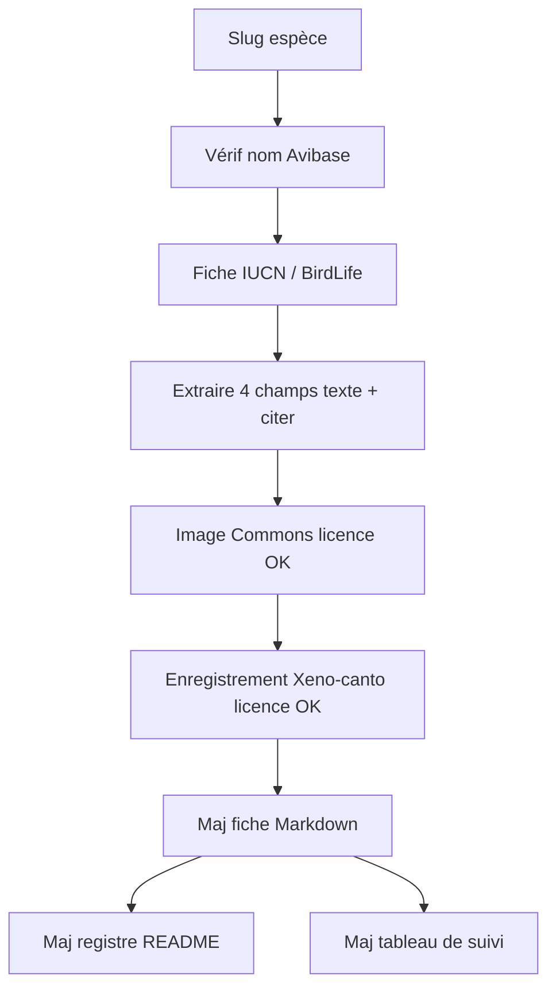

# Plan — Recherche de sources fiables par espèce (OrnithoDex)

Document de référence consolidé le **2026-10-10**.  
Complète le [plan projet V1](plan.md). Toute évolution de méthode doit mettre à jour ce fichier et le [journal](../journal/).

## Vue d’ensemble

Catalogue de sources publiques approuvées, puis enrichissement systématique des **85 fiches du naturaliste** (description, habitat, régime, dimorphisme + photo / chant libres de droits), avec registre dans le [README racine](../../README.md).

**Pas de polycopié / supports de cours pour l’instant.**

## Périmètre retenu

Pour chaque espèce du référentiel ([especes.md](../ornithologie/especes.md)) :

| Inclus | Exclu (pour l’instant) |
|--------|-------------------------|
| Description, dimorphisme, habitat d’origine, régime alimentaire | Points de cours BAC PRO / polycopié |
| 1 image libre de droits + 1 enregistrement sonore si disponible | Scaffold applicatif Vite/React |
| | Téléchargement massif dans `public/` avant validation licence |

Règle inchangée : pas de source = section vide ; rien n’est inventé ; toute source ajoutée au README racine. Voir [sources.md](../ornithologie/sources.md) et le [modèle de fiche](../ornithologie/modele-fiche-naturaliste.md).

## Catalogue de sources approuvées

À figer dans [`catalogue-sources.md`](../ornithologie/catalogue-sources.md) (livrable de la phase d’exécution) et à refléter dans `sources.md` + README.

| Id source | Organisme | Usage autorisé | Priorité |
|-----------|-----------|----------------|----------|
| `iucn-redlist` | IUCN Red List | Habitat, répartition, statut, traits généraux | Texte principal |
| `birdlife-datazone` | BirdLife International DataZone | Complément habitat / répartition | Texte |
| `avibase` | Avibase (Denis Lepage) | Vérif. taxonomique, liens croisés, noms | Contrôle + liens |
| `xeno-canto` | Xeno-canto | Chants / cris (licence CC de l’enregistrement) | Audio |
| `wikimedia-commons` | Wikimedia Commons | Photos (licence fichier + auteur) | Image |

**Non retenus comme source unique de faits** : Wikipedia, blogs, forums animalerie, contenu généré par IA. Wikipedia peut servir uniquement à *retrouver* une référence primaire, jamais à citer un fait seul.

**Cas domestiques** (ex. `Gallus gallus domesticus`, `Serinus canaria`, `Lonchura striata domestiqua`, `Streptopelia risoria`) : documenter explicitement la forme domestique vs l’espèce sauvage parente ; privilégier IUCN / sources sur le taxon sauvage pour l’habitat d’origine ; noter « forme domestique » sans inventer de standard d’élevage.

## Méthode par espèce (répétable)

1. Résoudre le nom scientifique (synonymes fréquents chez les estrildidés / psittacidés).
2. Ouvrir la fiche IUCN (et BirdLife si besoin) ; noter URL + date de consultation.
3. Remplir uniquement les phrases **traçables** (paraphrase courte ; pas de copier-coller long si droits douteux).
4. Chercher sur Commons une image claire, licence `CC0` / `CC BY` / `CC BY-SA` / domaine public ; consigner auteur + licence + URL.
5. Chercher sur Xeno-canto un enregistrement représentatif ; même exigence de licence / crédit.
6. `statut_documentation` → `partielle` dès qu’au moins un champ texte **ou** un média est sourcé ; `complete` seulement quand les 4 sections texte + image + audio sont sourcés.
7. Si introuvable : laisser vide et marquer `manquant` dans le suivi (pas de substitution hasardeuse).

## Suivi projet

Livrable : [`suivi-sources.md`](../ornithologie/suivi-sources.md) — tableau des 85 slugs avec colonnes :

`slug | iucn | birdlife | image | audio | description | dimorphisme | habitat | regime | notes`

Valeurs : `ok` / `manquant` / `na` (ex. audio indisponible pour une forme domestique rare).

## Ordre de travail

Par lots taxonomiques :

1. **Lot pilote** (6) : Galliformes + Ansériformes — valide le gabarit de citation et le flux README
2. Columbiformes (6)
3. Psittaciformes – Cacatuides (4) puis Psittacidés (sous-groupes de ~8)
4. Passériformes (par familles)

Après le lot pilote : entrée journal + ajustement éventuel du catalogue (sans élargir aux sources non fiables).

## Livrables de cette phase

- [ ] `catalogue-sources.md` + MAJ `sources.md`
- [ ] `suivi-sources.md` initialisé pour les 85 espèces
- [ ] Fiches enrichies lot par lot sous [`fiches-naturaliste/`](../ornithologie/fiches-naturaliste/)
- [ ] Section **Sources** du README : entrées génériques (IUCN, BirdLife, Avibase, Xeno-canto, Commons) + lignes médias par fichier dès qu’un asset est retenu
- [ ] Entrées journal à chaque lot terminé

## Hors cette phase

- Scaffold Vite / React
- Points de cours / polycopié
- Copie locale massive des médias avant validation licence (d’abord URL + crédit dans la fiche)

## Documents liés

- [Plan projet V1](plan.md)
- [Politique de sources](../ornithologie/sources.md)
- [Index ornithologie](../ornithologie/README.md)
