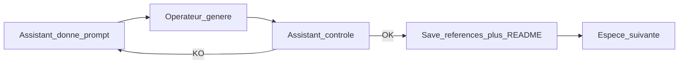

# Plan — Suivi illustrations (génération)

Document de référence consigné le **2026-10-10**. Complète le [plan prompts visuels](plan-prompts-visuels.md). Toute évolution majeure → ce fichier + [journal](../journal/).

## Vue d’ensemble

Passe opérationnelle : générer et valider les **85 illustrations naturalistes** une par une (prompts déjà produits par `npm run data:prompts`).

Rôles :

1. L’assistant fournit le prompt illustration (EN) + garde-fous
2. L’opérateur génère l’image et la fournit dans le chat
3. L’assistant contrôle, range le fichier, met à jour le catalogue, passe à l’espèce suivante

## Décisions

| Sujet | Choix |
|-------|--------|
| Périmètre | **Illustration uniquement** (pas 3D pour cette passe) |
| Ordre | [`_index.md`](../ornithologie/prompts-visuels/_index.md) — **repartir de 0** (`agapornis-fischeri`) |
| Stockage | `documentation/ornithologie/prompts-visuels/references/{slug}-illustration.jpg` (ou `.png` / `.webp`) |
| App | **Pas** d’intégration `public/images/birds/` tant que la passe n’est pas validée |
| Commit | Uniquement sur demande explicite |

## Boucle par espèce

1. **Prompt** — bloc « Prompt — illustration naturaliste (EN) » du fichier `{slug}.md` + garde-fous négatifs
2. **Génération** — opérateur colle / dépose l’image
3. **Contrôle** (checklist) :
   - silhouette lisible, vue 3/4 de côté
   - fond crème, style plat, contours navy `#1b365d` (pas noirs)
   - plumage / morphologie **uniquement** faits du prompt / fiche — zéro invention
   - pas de texte, watermark, cage, multi-sujets
4. **Si OK** — enregistrer sous `references/{slug}-illustration.*`, ligne dans [`references/README.md`](../ornithologie/prompts-visuels/references/README.md), puis `npm run data:prompts`
5. **Si KO** — feedback précis (1–3 points) ; même espèce ; pas d’avance
6. **Suivante** — espèce suivante dans `_index.md`

## Suivi de progression

- Source de vérité : fichiers `references/*-illustration.*` + catalogue README
- Pilote Fischer existant : **remplacé / revalidé** avec la nouvelle génération (repartir de 0)
- Critère de done passe : 85 illustrations validées en `references/`

## Hors périmètre

- Génération / validation des GLB 3D
- Publication des assets dans l’app (`public/`)
- Modification des prompts générés (sauf ajustement mineur des négatifs si échec répété)

## Documents liés

- [Plan prompts visuels](plan-prompts-visuels.md)
- [Sprint prompts visuels](sprint-prompts-visuels.md) (catalogue + carte — hors génération assets)
- [Charte design](design.md)
- [Index prompts](../ornithologie/prompts-visuels/_index.md)
- [Références](../ornithologie/prompts-visuels/references/README.md)
