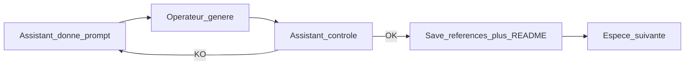

# Plan — Suivi illustrations (génération)

Document de référence consigné le **2026-10-10**. Complète le [plan prompts visuels](plan-prompts-visuels.md). Toute évolution majeure → ce fichier + [journal](../journal/).

**Branche** : `feature/suivi-illustrations` → PR vers `develop`

## Vue d’ensemble

Passe opérationnelle : générer et valider les **85 illustrations naturalistes** une par une (prompts déjà produits par `npm run data:prompts`).

Rôles :

1. L’assistant fournit le prompt illustration (EN) + garde-fous
2. L’opérateur génère l’image et la fournit dans le chat
3. L’assistant contrôle, range le fichier, met à jour le catalogue, passe à l’espèce suivante

## Décisions

| Sujet | Choix |
|-------|--------|
| Périmètre | **Illustration uniquement** (pas 3D pour cette passe) |
| Ordre | [`_index.md`](../ornithologie/prompts-visuels/_index.md) — **repartir de 0** (`agapornis-fischeri`) |
| Format image | **Carré** (1:1) — demandé dans le prompt unique |
| Prompt opérateur | **Un seul bloc collable** (négatifs fusionnés en « Avoid: … ») |
| Couleurs | **Photo de la fiche** (médias, licence OK) = référence plumage / couleurs. Le prompt ne décrit que le **cadrage, le style et la pose**. Ne pas recopier la pose de la photo si elle diffère |
| Reprise | On ne fournit pas l’espèce suivante tant que l’image en cours n’est pas validée |
| Progression | À chaque tour : `validées / 85`, espèce en cours, suivante |
| Stockage validation | `documentation/ornithologie/prompts-visuels/references/{slug}-illustration.jpg` (ou `.png` / `.webp`) |
| Usage app | **Collection + cadre fiche** = illustrations ; **bas de fiche + quiz** = photos Commons |
| Publication app | Après validation : copier vers `public/images/illustrations/{slug}.webp` (pas dans `images/birds/`) |
| App pendant la passe | ~~Pas d’intégration~~ → **fait** : `pnpm media:illustrations` + Collection via `bird.illustration` ; fallback = dégradé ordre |
| Commit | Uniquement sur demande explicite |

## Boucle par espèce

1. **Prompt** — un seul bloc collable : illustration EN (faits visuels) + format carré 1:1 + « Avoid: … » (négatifs)
2. **Génération** — opérateur colle / dépose l’image
3. **Contrôle** (checklist) :
   - format carré (1:1)
   - silhouette lisible, vue 3/4 de côté
   - fond crème, style plat, contours navy `#1b365d` (pas noirs)
   - plumage **uniquement** les couleurs nommées dans le prompt — toute autre teinte sur l’oiseau = KO
   - pas de texte, watermark, cage, multi-sujets
4. **Si OK** — enregistrer sous `references/{slug}-illustration.*`, ligne dans [`references/README.md`](../ornithologie/prompts-visuels/references/README.md), puis `npm run data:prompts`
5. **Si KO** — feedback précis (1–3 points) ; **même espèce uniquement** ; ne pas donner le prompt suivant
6. **Suivante** — espèce suivante dans `_index.md` dont la colonne Illustration est `prêt`
7. **Bloqué** — plumage absent de la fiche : ne pas générer ; ne pas inventer. Compléter la fiche depuis une source approuvée, puis `npm run data:prompts`

## Suivi de progression

- Source de vérité : fichiers `references/*-illustration.*` + catalogue README
- Pilote Fischer existant : **remplacé / revalidé** avec la nouvelle génération (repartir de 0)
- Critère de done passe : 85 illustrations validées en `references/`

## Usage produit (décision 2026-10-10)

| Surface | Visuel |
|---------|--------|
| **Collection** (tuiles) | Illustration naturaliste validée |
| **Fiche — cadre haut** | Illustration (1:1, sans crop tête) |
| **Fiche — bas** | Photo sourcée + crédit |
| **Quiz photo → nom** | Photo sourcée |

Conséquence : le cadrage « focus tête » s’applique à la photo (bas de fiche / quiz), pas aux illustrations.

## Hors périmètre

- Génération / validation des GLB 3D
- Remplacer les photos de fiche / quiz par les illustrations
- Modification des prompts générés (sauf ajustement mineur des négatifs si échec répété)

## Documents liés

- [Plan prompts visuels](plan-prompts-visuels.md)
- [Sprint prompts visuels](sprint-prompts-visuels.md) (catalogue + carte — hors génération assets)
- [Charte design](design.md)
- [Index prompts](../ornithologie/prompts-visuels/_index.md)
- [Références](../ornithologie/prompts-visuels/references/README.md)
