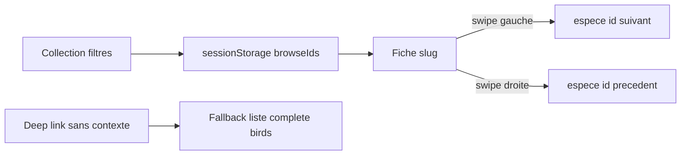

# Plan — Consultation des fiches par swipe

Consigné le **2026-10-11** (évaluation architecture → plan produit).  
Sprint d’exécution : [sprint-swipe-fiches.md](sprint-swipe-fiches.md).

## Verdict

**Faisable** ; maquette **validée** le 2026-10-11 (geste seul, sans chrome « Glisser »). Intégration React selon [sprint-swipe-fiches.md](sprint-swipe-fiches.md).

Flux actuel app : Collection → `/espece/:slug` → retour « ← Collection » uniquement.

## Objectif

Permettre de parcourir les fiches du naturaliste par **swipe horizontal** (gauche = suivante, droite = précédente) **sans repasser par la liste** Collection.

## Décision produit

Le parcours suit la **liste filtrée** vue en Collection (recherche + filtre ordre).  
Deep link / refresh sans contexte → fallback : catalogue `birds` complet (ordre dataset).

## Approche technique (après validation maquette)

1. Maquette / prototype fiche (geste + index `n / N`, **sans** « Glisser ») — **validée 2026-10-11**
2. À l’ouverture depuis Collection : persister les ids filtrés (`sessionStorage`, clé `ornithodex.browse.ids`)
3. Fiche : résoudre prev/next ; extrémités = no-op
4. Gesture touch maison (seuil ~50–70 px, axe horizontal dominant) ; `navigate(..., { replace: true })`
5. Fallback catalogue si pas de contexte
6. Desktop V1 : pas de drag souris ni flèches clavier

## Risques

| Risque | Mitigation |
|--------|------------|
| Conflit scroll vertical fiche | Seuil + `|dx| > |dy|` |
| Historique navigateur gonflé | `replace: true` pendant le parcours |
| Accessibilité | `aria-live` du nom après changement (pas de hint visible) |
| Deep link | Fallback catalogue complet |

## Hors scope

- Carousel plein écran multi-slides / lib type Embla
- Préchargement agressif de toutes les images
- Filtre famille (absent de l’UI Collection actuelle)

## Effort

| Phase | Effort |
|-------|--------|
| Maquette + validation | 0,5 j |
| Contexte + gesture React | 0,5 j |
| Polish (scroll, a11y, extrémités) | 0,25 j |

## Prochaine étape

Intégration React : `lib/browse.ts` + gesture sur `BirdSheetPage` (phases 1–4 du sprint).

## Documents liés

- [sprint-swipe-fiches.md](sprint-swipe-fiches.md)
- [maquettes/](maquettes/) — prototype interactif
- [design.md](design.md) — specs fiche
- [plan-ui-equiv-maquette.md](plan-ui-equiv-maquette.md)
