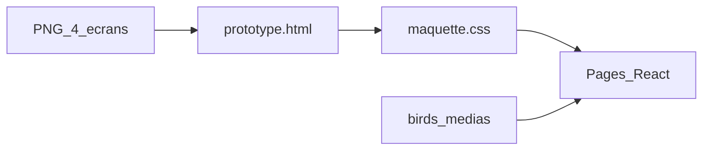

# Plan — UI/UX équivalente à la maquette

Document de référence consigné le **2026-10-10**. Complète le [plan projet](plan.md) et la [charte design](design.md). Toute évolution majeure → ce fichier + [journal](../journal/).

Sprint d’exécution : [sprint-ui-equiv-maquette.md](sprint-ui-equiv-maquette.md).

## Vue d’ensemble

Reprendre **toute** la couche UI/UX de l’app React pour qu’elle soit l’**équivalent** structurel et visuel du référentiel Livrable B — **zéro contrôle inventé** hors maquette.

## Référentiel (source de vérité)

| Asset | Écran |
|-------|--------|
| [maquettes/accueil.png](maquettes/accueil.png) | Accueil |
| [maquettes/collection.png](maquettes/collection.png) | Collection |
| [maquettes/fiche.png](maquettes/fiche.png) | Fiche du naturaliste |
| [maquettes/quiz.png](maquettes/quiz.png) | Quiz photo |
| [maquettes/prototype.html](maquettes/prototype.html) | Interactions + CSS |

Règle non négociable : **la maquette prime**. Si un contrôle n’apparaît pas dans les PNG / le prototype référentiel, il n’existe pas dans l’app.

## Contexte

| Élément | État |
|---------|------|
| Livrable B (PNG + prototype) | Consigné ; app actuelle **divergente** |
| Tentatives d’alignement partielles | Insuffisantes ; ajouts hors PNG (combo, toggle colonnes, parallax) à **retirer** |
| Dataset / médias | Conservés ; branchés **dans** le chrome maquette |
| Carte `wildRange` | Données OK ; **hors UI fiche** tant que la maquette ne l’inclut pas |

## Décisions

| Sujet | Choix |
|-------|--------|
| Méthode | **Porter** le chrome (classes / structure DOM du prototype), ne pas « s’inspirer » |
| Collection | Chips ordre (Tous + 5 ordres) + grille **2 colonnes** fixe |
| Accueil | Logo JPG + bob ; tagline pilule ; 2 CTA avec icônes ; pas de H1 marque séparé |
| Contenu média | Photos / audio réels **à la place** des dégradés placeholder — même layout |
| Famille (Collection) | Pas de filtre famille UI (absent des captures) |
| Invention UI | Interdite |

## Principe d’implémentation

1. Extraire le CSS du prototype vers `src/styles/maquette.css` (mêmes noms de classes).
2. Réécrire les pages pour mirroir le DOM du prototype.
3. Brancher les données réelles dans ce chrome uniquement.

## Livrable — Écrans

### Accueil

- Logo grand + bob ; tagline « Apprends les oiseaux en t’amusant »
- 2 CTA icônes : Collection / Entraînement
- Pas de parallax hors maquette ; pas de stats / listes

### Collection

- Titre + sous-titre maquette
- Search « Nom commun ou latin… »
- Chips horizontales `aria-pressed` : Tous + ordres
- Grille 2 colonnes ; carte 3:4 + nom + meta point + ordre

### Fiche

- Retour ghost « ← Collection »
- Média bordé ; nom / latin / pills
- Points `[programme|sourcé] — …`
- Sources en bas
- Pas de `WildRangeMap` tant que non maquetté

### Entraînement / Quiz

- Hub 2 modes (chrome maquette ; chant désactivé si médias insuffisants)
- Quiz : Modes + score `n / n` ; prompt ; stimulus ; 4 réponses ; suivant lime → leaf

### Nav

- Tabbar ~68 px : Accueil · Collection · Entraînement — icônes + underline orange actif

## Critères de done

- [ ] Équivalence visuelle vs PNG (structure, copy, contrôles)
- [ ] Aucun contrôle UI absent des captures
- [ ] Prototype HTML resynchronisé sur les PNG (sans ajouts hors référentiel)
- [ ] `design.md` cohérent avec ce plan
- [ ] `npm run build` OK
- [ ] Journal + PR → `develop`

## Hors périmètre

- Refaire / revalider les assets PNG
- Génération Meshy / prompts
- Remettre carte répartition ou autres UI avant validation maquette

## Documents liés

- [Sprint](sprint-ui-equiv-maquette.md)
- [Charte design](design.md)
- [Plan design](plan-design.md)
- [Plan projet](plan.md)
- [Pédagogie](pedagogie.md)
