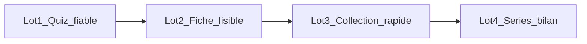

# Plan — Passe critique UI / UX / ergonomie

Consigné le **2026-10-11** (revue téléphone 390 px + code app 0.2.0).  
Sprint d’exécution : [sprint-ui-ux-ergonomie.md](sprint-ui-ux-ergonomie.md).

## Objectif

Corriger les frictions qui gênent la **rétention** (seconde pro TCVA, smartphone) sans inventer de contenu biologique ni alourdir les écrans.

Ordre des lots = impact apprentissage décroissant : quiz → fiche → collection → séries.

## Constat (revue 2026-10-11)

### Quiz (priorité haute)

| Problème | Impact |
|----------|--------|
| `.stimulus` sans `flex-shrink: 0` → photo écrasée après réponse | L’élève perd l’image au moment de comparer |
| Indice : markdown brut (`\*…\*`) ; fallback souvent = ligne d’identité | Pas d’aide réelle au contraste |
| Barre « ← Modes » / score mal calée ; score cumulé sans série | Confusion + pas de fin de parcours |
| « Revoir la fiche » → retour Collection + swipe browse | Casse le fil d’entraînement |

### Fiche

| Problème | Impact |
|----------|--------|
| Illustration 1:1 = premier écran entier (~3000 px de scroll) | Nom / pastilles sous la ligne de flottaison |
| Étiquettes `[programme]` / `[sourcé]` + ids techniques visibles | Jargon hors charte pédagogique élève |
| 6 blocs encyclopédiques après les points de cours | Contredit « 1 écran = 1 job » ([design.md](design.md)) |
| Pas de flèches clavier (swipe touch / pointeur seulement) | Desktop / clavier incomplet |

### Collection

| Problème | Impact |
|----------|--------|
| Révélation 85/85 + `loading="eager"` partout | Squelette long en 4G |
| Recherche sensible aux accents ; pas de compteur / clear | « inseparable » ne trouve pas Inséparable |
| Filtre Famille absent (prévu charte) | Filtre incomplet |
| 4 colonnes : nom ~0,68 rem ; pastille ordre redondante | Illisible |

### Accueil / Entraînement / a11y

- Modes sans effectifs (85 photos / ~50 chants) ; zone vide sous les CTA.
- Après réponse quiz : focus perdu (boutons `disabled`) au lieu d’aller sur « Question suivante ».
- Label recherche : style inline plutôt que classe `.sr-only`.

## Plan d’amélioration

### Lot 1 — Quiz fiable

- [src/styles/maquette.css](../../src/styles/maquette.css) : `.stimulus { flex-shrink: 0 }` ; score `nowrap` ; « ← Modes » à gauche.
- Extraire `renderInlineMarkdown` → `src/lib/text.tsx` ; l’utiliser pour l’indice.
- Indice : uniquement point de **contraste** (`ne pas confondre` / `même genre`) ; sinon **aucun** indice (pas la ligne d’identité).
- Focus clavier → « Question suivante » après réponse.
- « Revoir la fiche » : `state: { from: '/entrainement/…' }` → retour « ← Quiz », swipe désactivé.

### Lot 2 — Fiche lisible

- Illustration ~45 % viewport : nom + latin + pastilles visibles sans scroll.
- Points de cours : icônes (livre / loupe) + libellé accessible ; sources en titre court (BirdLife, ADW), pas d’id technique.
- Sections encyclopédiques dans `
` « En savoir plus » (fermé par défaut) ; photo + Sources restent visibles.
- Flèches ← → clavier → `goPrev` / `goNext` ; **pas** de boutons chrome (décision swipe 2026-10-11).

### Lot 3 — Collection rapide

- Révélation dès **première rangée** prête ; `lazy` au-delà de 2 rangées.
- Recherche NFD + sans diacritiques ; compteur « N espèces » ; bouton clear.
- Filtre Famille (familles de l’ordre sélectionné).
- 4 colonnes : masquer pastille ordre ; nom ≥ 0,75 rem.

### Lot 4 — Séries et bilan

- Entraînement : effectifs par mode ; choix série 10 / 20.
- Quiz : compteur `k / N` ; pas de répétition d’espèce dans la série ; écran bilan (score, ratées → fiches, « Rejouer les ratées »).
- Score série en mémoire ; cumul `localStorage` remettable depuis Entraînement.
- Bilan = noms + liens fiches existantes uniquement (zéro texte inventé).

## Hors périmètre

- Nouveaux modes de quiz, comptes élèves, PWA offline.
- Modification des faits / fiches naturalistes.
- Redesign marque / logo.

## Effort indicatif

| Lot | Effort |
|-----|--------|
| 1 Quiz | 0,5 j |
| 2 Fiche | 0,5–0,75 j |
| 3 Collection | 0,5 j |
| 4 Séries | 0,75–1 j |

## Documents liés

- [sprint-ui-ux-ergonomie.md](sprint-ui-ux-ergonomie.md)
- [design.md](design.md)
- [pedagogie.md](pedagogie.md)
- [plan-swipe-fiches.md](plan-swipe-fiches.md)
- [plan-remediation-pedagogie-0.3.md](plan-remediation-pedagogie-0.3.md) — feedback quiz / sources (complémentaire)
