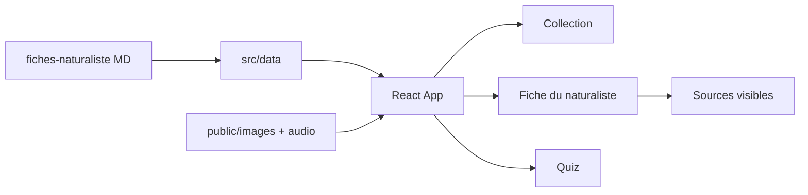
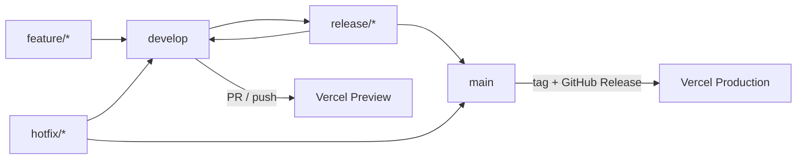

# Plan du projet — OrnithoDex

Document de référence consolidé le **2026-10-10**. Toute évolution majeure du cadrage doit mettre à jour ce fichier et une entrée du [journal](../journal/).

## Vue d’ensemble

**OrnithoDex** — site pédagogique **open source**, PWA **mobile-first** (portrait smartphone) : collection type cartes + **fiche du naturaliste** (informations 100 % sourcées) + modes quiz. Code sur GitHub public (repo **OrnithoDex**, Gitflow), production Vercel (projet **OrnithoDex**) déclenchée par **GitHub Release**.

Stack : **Vite + React + TypeScript + Tailwind CSS**.

## Objectif V1

Application web **statique** pour mémoriser les oiseaux de cage et de volière (MP6 – BAC PRO TCVA) :

- Collection interactive (cartes + **fiche du naturaliste**)
- Filtres / recherche (ordre, famille, nom)
- Lecture audio (bouton prêt ; fichiers à brancher plus tard)
- Modes quiz (photo → nom, chant → espèce)

Public principal : adolescents / étudiants sur **téléphone** (usage une main, portrait). Desktop = bonus, pas la cible de design.

**Hors V1** : PDF cartes physiques, compte utilisateur, backend, app store native.

## Projet open source et transparence des sources

- Licence **MIT** pour le code.
- Contenus pédagogiques et médias tiers : attribution via le **registre des sources** du [README racine](../../README.md).
- Le README racine liste **toutes** les sources du projet (programme, ouvrages, sites, photos, sons).
- Détail de la politique : [ornithologie/sources.md](../ornithologie/sources.md).
- Toute nouvelle source (fiche ou asset) **doit** être répercutée dans le README — pas de source cachée.

## Règle d’intégrité scientifique (non négociable)

- **Interdit d’inventer** morphologie, comportement, habitat, chant, statut, etc.
- Toute information hors identité programme **doit être sourcée** ; source visible dans l’app **et** dans le registre README / doc.
- Champ sans source fiable → **laisser vide** / « Non documenté ».
- Identité programme (latin, commun, ordre, famille) : source = liste officielle BAC PRO TCVA / arrêtés — voir [programme.md](../ornithologie/programme.md).
- Enrichissements : uniquement avec sources validées, consignées dans la fiche **et** le README.

## Phase 0 — Base documentaire (avant le code)

Structure cible :

```
documentation/
  README.md
  projet/
    plan.md                     # ce document
    vision.md
    cahier-des-charges.md
    architecture.md
    conventions.md
  journal/
    README.md
    2026-10-10.md
  ornithologie/
    README.md
    programme.md
    taxonomie.md
    especes.md
    glossaire.md
    sources.md
    modele-fiche-naturaliste.md
    fiches-naturaliste/
      _index.md
      {slug}.md
```

Chaque espèce a une **fiche du naturaliste** Markdown. En phase 0 : gabarit + squelettes (identité programme seule). Aucune biologie inventée.

## Stack et hébergement

| Élément | Choix |
|---------|--------|
| Front | Vite, React, TypeScript, Tailwind CSS |
| Données | JSON/TS versionnées (pas de backend) |
| Code | GitHub — repo public **OrnithoDex** |
| Site | Vercel — projet **OrnithoDex** |

## Architecture



### Structure applicative prévue

```
ornithologie/
  documentation/ornithologie/fiches-naturaliste/
  public/
    images/birds/{slug}.webp
    audio/birds/{slug}.mp3
  src/
    data/birds.ts
    types/bird.ts
    components/
    pages/
    lib/quiz.ts
  index.html
```

### Modèle de données (par espèce)

```ts
type SourceRef = {
  id: string;
  title: string;
  publisher?: string;
  year?: string;
  url?: string;
  note?: string;
};

type SourcedText = {
  text: string;
  sourceIds: string[]; // obligatoire si text non vide
};

// Espèce
{
  id: "coturnix-chinensis",
  scientificName: "Coturnix chinensis",
  commonName: "Caille peinte de Chine",
  order: "Galliformes",
  family: "Phasianidés",
  programSourceId: "bac-pro-tcva-liste",
  image: "/images/birds/coturnix-chinensis.webp",
  audio: ["/audio/birds/coturnix-chinensis.mp3"],
  sheet: {
    status: "liste_seule", // | partielle | complete
    sections: SourcedText[],
  },
  sources: SourceRef[]
}
```

## UI / UX — mobile-first portrait

Thème **naturaliste pédagogique** (verts forêt / bleus ciel / accents par ordre), typographie expressive, fond texturé léger.

Contraintes smartphone :

- Portrait, viewport ~360–430 px
- Navigation basse / compacte (pouce)
- Cartes en colonne (max 2 sur grands téléphones)
- Zones tactiles ≥ 44 px ; quiz : réponses empilées pleine largeur
- Safe-areas ; images ratio ~3:4
- Manifest PWA (ajout à l’écran d’accueil)
- Desktop : colonne centrée ~480–560 px

| Écran | Contenu |
|--------|---------|
| Accueil | Marque + 2 gros CTA : Collection / Entraînement |
| Collection | Liste, recherche, filtres Ordre / Famille |
| Fiche du naturaliste | Carte + corps ; indicateurs de source ; bloc Sources ; audio |
| Quiz | Une question par écran, 4 réponses, score |

Quiz V1 : uniquement faits **présents et sourcés** (a minima identité programme).

## Modes quiz (V1)

1. **Photo → nom** : image, 4 propositions
2. **Chant → espèce** : audio, 4 propositions (si audio absent : question sautée / désactivée)

Progression en `localStorage`.

## Assets

- Images : `public/images/birds/{slug}.webp` (ou `.jpg`)
- Audio : `public/audio/birds/{slug}.mp3`
- Placeholder si fichier absent ; crédits obligatoires dans le README dès ajout

## GitHub + Gitflow + Vercel



- Branches protégées : `main`, `develop`
- Preview Vercel sur `develop` / PR
- **Production uniquement** sur événement GitHub `release: published` (Actions + secrets Vercel)

Flux : feature → `develop` → `release/x.y.z` → `main` → tag + Release → prod Vercel.

## Feuille de route d’implémentation

0. Base documentaire (en cours / ce dossier)
1. Scaffold Vite / React / TS / Tailwind
2. Types sourcés + dataset aligné sur les fiches
3. UI Collection + fiche du naturaliste
4. Quiz (2 modes)
5. Placeholders + README racine (registre sources)
6. Gitflow + Vercel
7. Enrichissement progressif des fiches **uniquement** avec sources validées

## Critères de done V1

- [ ] `documentation/` complète ; politique de sourcing ; fiches squelettes
- [ ] `README.md` racine avec section **Sources** exhaustive
- [ ] Aucune information inventée ; aucune source absente du README
- [ ] Espèces consultables ; fiche du naturaliste avec sources visibles
- [ ] UI fluide en portrait smartphone
- [ ] Audio opérationnel dès fichier présent
- [ ] Quiz photo et chant jouables
- [ ] Manifest PWA minimal
- [ ] `npm run build` OK
- [ ] Repo GitHub public (Gitflow) ; preview Vercel ; prod sur Release

## Documents liés

- [Plan sources](plan-sources.md) — enrichissement des fiches (sources publiques)
- [Vision](vision.md)
- [Cahier des charges](cahier-des-charges.md)
- [Architecture](architecture.md)
- [Conventions](conventions.md)
- [Ornithologie](../ornithologie/README.md)
